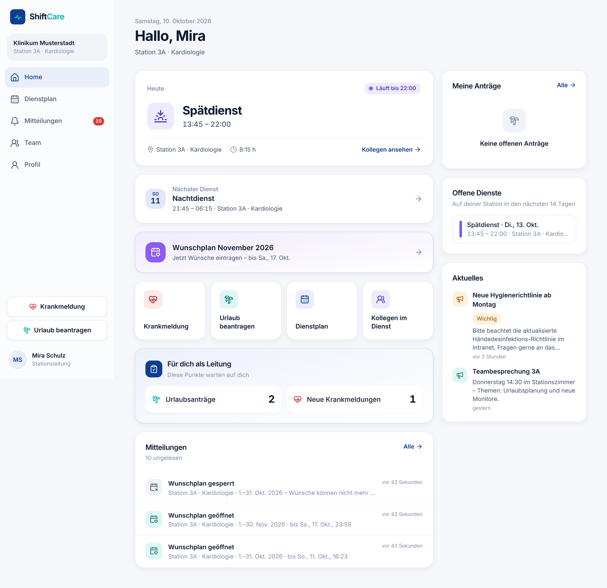
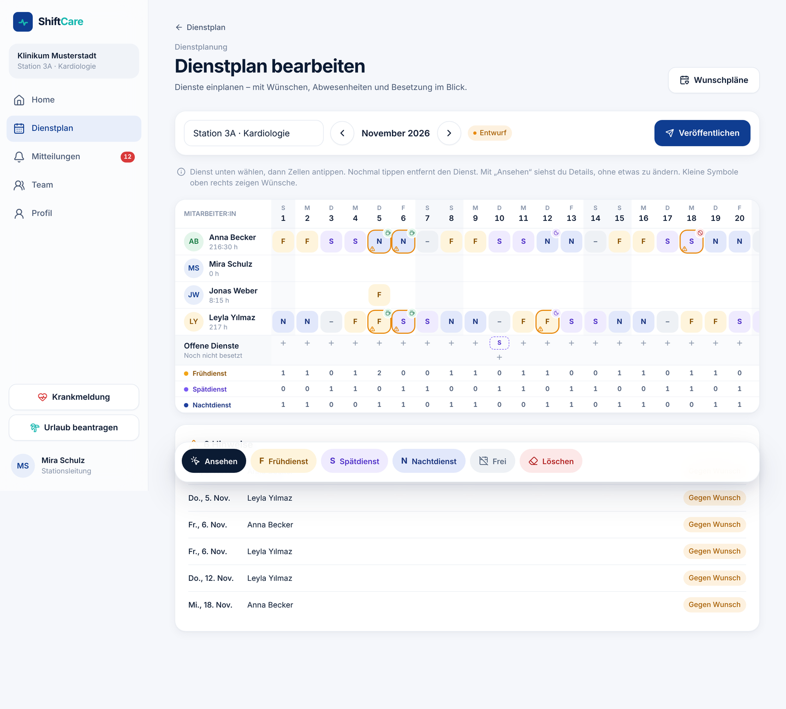

# ShiftCare

Moderne SaaS-Plattform für Krankenhäuser und Pflegeeinrichtungen: Dienstplan, Kollegen im Dienst, Krankmeldung, Urlaub, Benachrichtigungen und Profil – mandantenfähig, sicher und als Web-App sowie später für iOS und Android.

| Bereich | Technologie |
| --- | --- |
| Frontend | React 19, TypeScript (strict), Vite, Tailwind CSS 4, TanStack Query, React Router 7, i18next |
| Backend | Supabase: PostgreSQL 15+ mit Row Level Security, Auth, Storage, Realtime, Edge Functions |
| Mobile | iOS- und Android-App (Capacitor) aus derselben Web-App, Store-Einträge in 5 Sprachen (siehe [docs/APP-STORES.md](docs/APP-STORES.md)) |

## Demo

**[▶ Zur Demo mit Videos und Screenshots](docs/DEMO.md)**

| | |
| --- | --- |
|  |  |
| [▶ Video: Pflegekraft am Smartphone](docs/demo/demo-pflegekraft-smartphone.webm) | [▶ Video: Stationsleitung am Desktop](docs/demo/demo-stationsleitung-desktop.webm) |

## Dokumentation

- [docs/ARCHITECTURE.md](docs/ARCHITECTURE.md): Schichten, Ordnerstruktur, Datenfluss, Auth, Push, Mobile
- [docs/DATABASE.md](docs/DATABASE.md): Datenmodell, Mandantentrennung, Rollen & Rechte, Indizes, Designentscheidungen
- [docs/SECURITY.md](docs/SECURITY.md): RLS, Verschlüsselung, Audit-Log, Least Privilege, Betrieb
- [docs/DESIGN.md](docs/DESIGN.md): Designsystem, Navigation, UX-Regeln
- [docs/DIENSTPLAN-EDITOR.md](docs/DIENSTPLAN-EDITOR.md): Dienstplan-Editor (Bedienung, Hinweise, Technik)
- [docs/WUNSCHPLAN.md](docs/WUNSCHPLAN.md): Wunschplan (Ablauf, Datenmodell, Rechte, KI-Vorbereitung)
- [docs/INTEGRATION-HUB.md](docs/INTEGRATION-HUB.md): Dienstplan-Import (CSV/XLSX), Adapter-Architektur, Dienstplanmodell, was funktioniert und was nicht
- [docs/LEITUNG-UND-VERWALTUNG.md](docs/LEITUNG-UND-VERWALTUNG.md): Aktuelles, Vertretung bei Krankheit, offene Dienste, Verlauf, Verwaltung
- [docs/STATIONSCHAT.md](docs/STATIONSCHAT.md): Chat pro Station – wer liest mit, Moderation, Benachrichtigungen, Datenschutz
- [docs/RELEASE-OHNE-MAC.md](docs/RELEASE-OHNE-MAC.md): App in TestFlight und Google Play bringen – nur mit iPad und GitHub
- [docs/APP-STORES.md](docs/APP-STORES.md): native Apps, Store-Texte, Screenshots, Datenschutzangaben, Push, Einreichung – was fertig ist und was du noch tun musst
- [docs/OPEN_POINTS.md](docs/OPEN_POINTS.md): **offene Fragen und getroffene Annahmen, bitte prüfen**

## Schnellstart (lokal mit Supabase CLI)

```bash
npm install
supabase start                 # Postgres, Auth, Storage, Realtime (Docker)
supabase db reset              # Migrationen + supabase/seed.sql
cp .env.example .env.local     # URL + anon key aus `supabase status`
npm run dev                    # http://localhost:5173
```

Entwicklungs-Accounts aus dem Seed (Passwort `ShiftCare!2026`):

| E-Mail | Rolle |
| --- | --- |
| `anna.becker@shiftcare.dev` | Pflegekraft, Station 3A |
| `jonas.weber@shiftcare.dev` | Pflegekraft + Schichtleitung, Station 3A |
| `mira.schulz@shiftcare.dev` | Stationsleitung 3A (`head_nurse`, Scope Station) |
| `paul.richter@shiftcare.dev` | Pflegedienstleitung Innere Medizin (`head_nurse`, Scope Abteilung) |
| `hanna.koch@shiftcare.dev` | HR |
| `admin@shiftcare.dev` | Krankenhaus-Administration |
| `tom.fischer@shiftcare.dev` | Pflegekraft in einem **anderen** Krankenhaus (Mandantentest) |

## Qualitätssicherung

```bash
npm run check          # Typecheck + ESLint + Unit-Tests (Domänenlogik)
node scripts/check-i18n.mjs   # alle 5 Sprachen vollständig, alle Schlüssel vorhanden
npm run test:db        # Migrationen + Seed + RLS-Testsuite gegen PostgreSQL (PG* Variablen setzen)
```

`npm run test:db` braucht weder Docker noch die Supabase CLI: Ein kleiner Shim (`supabase/tests/support`) bildet die Supabase-Plattformobjekte nach (Rollen, `auth.uid()`, Storage, Vault). Die Testsuite `supabase/tests/01_rls_tenant_isolation.test.sql` prüft u. a. Mandantentrennung, Rollenrechte, Workflows, Verschlüsselung, Privilege Escalation und Integritätsregeln.

Für Browser-Ende-zu-Ende-Tests ohne Docker gibt es `scripts/e2e/gateway.mjs`, einen minimalen Ersatz für die Supabase-API, der jede Anfrage mit echter RLS als `authenticated` ausführt, sowie `scripts/e2e/smoke.mjs` (Playwright: Screenshots aller Hauptseiten in Light/Dark auf Phone/Tablet/Desktop und ein vollständiger Ablauf Urlaubsantrag → Genehmigung → Benachrichtigung).

### Demo-Video aufnehmen

`scripts/e2e/demo-tour.mjs` nimmt einen geführten Rundgang mit deutschen Untertiteln auf. Es entstehen zwei Videos: Pflegekraft am Smartphone und Stationsleitung am Desktop. Voraussetzung sind laufendes Gateway, laufender Dev-Server und ein frischer Seed.

```bash
node scripts/e2e/demo-tour.mjs demo-videos   # FFMPEG=/pfad/zu/ffmpeg optional
```

## Projektstruktur

```
src/
  app/          App-Rahmen: Router, Guards, Shell, Navigation
  core/         Infrastruktur: Konfiguration, Supabase-Client, i18n, Theme, Formatierung, Fehler
  domain/       reine Geschäftslogik & Typen (framework-frei, getestet); integration/ = Import-Adapter und Parser
  data/         Repositories: einziger Ort mit Supabase-Zugriff, Mapping Row → Domäne
  features/     Fachbereiche (dashboard, schedule, team, leave, sick-leave, news, staffing, admin, import, wishes, roster-editor, notifications, profile, auth, tenant)
  components/   fachliche, wiederverwendbare Bausteine (Avatar, Schicht-Farben, Status-Badges)
  ui/           Designsystem (Button, Card, Sheet, Field, SegmentedControl …)
  locales/      de, en, tr, ro, pl
supabase/
  migrations/   Schema, RLS, API-Funktionen, Trigger (versioniert)
  functions/    Edge Functions (push-dispatch, invite-employee)
  tests/        SQL-Testsuite + Plattform-Shim
  seed.sql      Entwicklungsdaten
```
